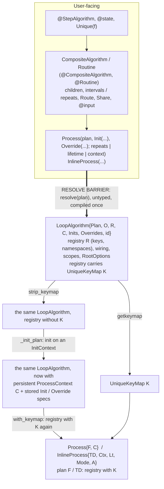
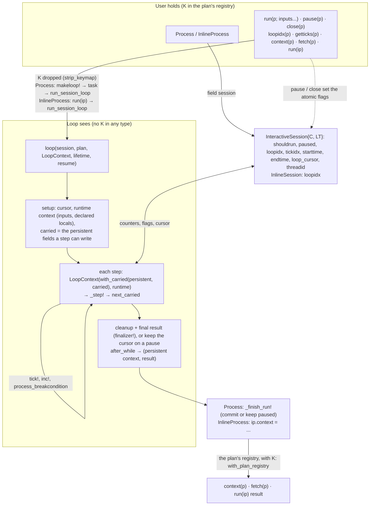

# [Process Pipeline Internals](@id process_pipeline_internals)

This page follows a plan from what the user writes to the loop that runs it and back: how a composition of
algorithms becomes a `Process` or `InlineProcess`, which internal structs a run is made of (the session, the loop's
two contexts, the bundle a step gets, the carried fields), and how the result is handed back to the user. It covers
`Process` and `InlineProcess`; `TimedProcess` and the process managers are not covered here.

Why the run is split over these intermediates (the session, the plan and context without the `UniqueKeyMap`) is
explained on its own page: [Why Processes Run Through Sessions](@ref process_sessions_why).

## 1. Overview

What the user holds is typed on the plan's `UniqueKeyMap` (`K`, the numbers of its `Unique` handles). What the loop
is compiled for never has `K` in its type. `K` lives in one place only: the registry's type (`NameSpaceRegistry{E, M}`,
`M` = `K`), in the plan and in the contexts the user holds. The resolve barrier is where the user's plan becomes a
resolved `LoopAlgorithm`; `K` is dropped where the plan and the context are handed to the loop as its arguments
(`strip_keymap` in `makeloop!`; an `InlineProcess` keeps them so, `loop_algo`, `context`, `set_loop_context!`).





## 2. Plans and Composition

What the user writes:

1. Algorithms and states: `@StepAlgorithm` (`src/ProcessEntities/StepAlgorithmMacro.jl`) and `@state`.
   `Unique(f)` makes a handle: the same algorithm again, as its own registry entry with its own state.
2. Plans: `CompositeAlgorithm` (children stepped on intervals, `src/LoopAlgorithms/CompositeAlgorithms.jl`) and
   `Routine` (children repeated, `src/LoopAlgorithms/Routines/Routines.jl`), written directly or with the
   `@CompositeAlgorithm` / `@Routine` DSL (`src/CompositeDSL/Macros.jl`). A plan stores the block as written: its
   children (`funcs`), their schedule (`intervals` or `repeats`), `namespaces`, its route/share `wiring`, its own
   `states` (`@state`, `@input`) and its other `options`.
3. Plans nest: a plan can be the child of another plan.

Both plan constructors strip the uuids of `Unique` handles from their inputs first (`strip_unique`), so building a
plan compiles once for new handles. A bare algorithm given to a process is wrapped as a one-child
`CompositeAlgorithm` (`normalize_process_algo`, `src/ConstructorCommon.jl`).

## 3. The Resolve Barrier

`resolve(plan)` (`src/LoopAlgorithms/Resolving/Resolving.jl`) is where the plan as written becomes a plan that can be
run. It does everything that needs the whole composition:

1. Registry: every algorithm and state in the tree gets a key (`Sensor_1`, `Sensor_2`, ...), and the key goes into its
   plan's `namespaces`. Nested `LoopAlgorithm` / `FinalizedAlgorithm` wrappers are replaced by their plans.
2. The registry is attached to the root wrapper. A bare plan is wrapped in a `LoopAlgorithm` first, so the result of
   `resolve` is always a `LoopAlgorithm` (or a `FinalizedAlgorithm` around one).
3. Wiring: route and share endpoints become context keys.
4. Scopes: each plan node records in its `PlanWiring` type which declared locals and captured returns its children see.
5. The plan tree's `RootOption`s are collected onto the `LoopAlgorithm`.
6. The plan's `UniqueKeyMap` (`unique_key_map`: the `k => uuid` pairs of its numbered `Unique` handles) is put into the
   registry's type (`with_keymap`).

It is a barrier because `resolve` is `@nospecializeinfer`: it is compiled once and its result is not inferred (a caller
gets `Any`). The steps themselves run in `_resolve_plan`, compiled once per plan type, on a registry without a map. An
already resolved plan is returned as it is.

The `LoopAlgorithm` (`src/AbstractTypeDefs.jl`) is what both resolve and init fill in:

| Field | Set by | Holds |
|:--|:--|:--|
| `plan` | the user's plan, rewritten by `resolve` | the plan tree, children keyed, wiring and scopes resolved |
| `options` | `resolve` | `RootOption`s of the whole tree (`RuntimeInputs`, `Redirect`, ...) |
| `reg` | `resolve` | the `NameSpaceRegistry{E, M}`; `M` is the `UniqueKeyMap` or `Nothing` |
| `context` | init | the persistent `ProcessContext` |
| `inits`, `overrides` | init | the `Init` / `Override` specs, replayed by a later `init` |

## 4. Building a Process

`Process(...)` and `InlineProcess(...)` (`src/Process.jl`, `src/InlineProcess.jl`) are `@nospecializeinfer`, and their
keyword calls are written out by hand (`Core.kwcall`), as Julia's own keyword method specializes on the keywords'
`NamedTuple`, whose type has the handles' uuids when a lifetime holds a `Var`. In order:

1. Wrap a bare algorithm (`normalize_process_algo`) and `resolve` the plan (section 3).
2. Take the map: `keymap = getkeymap(algo)`.
3. Strip it: `strip_keymap(algo)` and `strip_keymap(context)` (a context the user passed). From here on nothing has `K`.
4. Number the lifetime: its `Var`s may name `Unique` handles, so they get the plan's numbers while the map is known
   (`number_by_keymap_dynamic`).
5. Normalize the lifetime: `repeats = n` becomes `Repeat(n)`, `repeats = Inf` becomes `Indefinite()`; with neither,
   a `Routine` gets `Repeat(1)` and anything else `Indefinite()` (`normalize_process_lifetime`). `InlineProcess`
   defaults to one repeat.
6. Init (section 5), unless the plan already has a context. A `context` passed to the constructor is used instead.
7. Construct, the only step typed on `K` (`_construct_process`, `_construct_inline_process`). The initialized plan
   gets its registry with `K` back (`with_keymap`), and the process holds it so: `K` is in the process's type only
   through the plan's registry; the process has no field of its own for it.
   - `Process{F, C}`: `F` the plan type (registry with `K`), `C` the plan's cursor type
     (`loop_cursor(plan, Val(true))`). It gets a new `InteractiveSession{C, LT}` and is registered in the process list.
   - `InlineProcess{TD, ContextType, Lt, Mode, A}`: `TD` the plan type (registry with `K`); `loop_algo` (`A`) and
     `context` (`ContextType`) are the plan and the context without `K`, as the loop takes them as arguments; its
     `InlineSession` holds only the counter. Its lifetime's `Var`s get their context
     keys here (`resolve_var_keys`), so the loop does not look them up.
8. `precompile_interface(p)` (`src/PrecompileInterface.jl`) compiles what a first run calls with `p` (typed on `K`, so
   compiled for every set of handles): for a `Process`, `run(p)`, its `_makeloop!` and the task body; for an
   `InlineProcess`, `run(ip)`.

## 5. Init

`_init_plan(la, specs...; lifetime)` (`src/LoopAlgorithms/RuntimeInputs.jl`) runs on the resolved plan without the
map. It adds no structure; it fills in the persistent context and stores the specs:

1. Resolve the `Init` / `Override` / `Interactive` targets through the registry.
2. Merge the passed specs over the stored ones, per target.
3. Build an empty persistent `ProcessContext` from the registry, and merge the `Init` values into it.
4. Run `init` on an `InitContext(persistent context, la, lifetime)` (section 8): each registered algorithm's and
   state's init. The lifetime is there so init can size buffers (`processsizehint!`).
5. Merge the `Override` values, apply the `Interactive` specs, then the `Redirect`s.
6. Store the context and the specs on the `LoopAlgorithm` (`_with_lifecycle`).

The public `init(la, specs...)` does the same around the barrier: resolve, strip the map, `_init_plan`, put the map back.

## 6. From the User's Handle to the Internal Structs

A process is the user's handle; the loop never gets it. The loop gets the plan and the context as arguments, and the
run's record (counters, flags, times, cursor) in the session, a mutable struct the process holds and passes to the loop
(`src/Sessions/`); no session holds a context. The process keeps what lives
between runs (the plan with its context and its registry with `K`, the lifetime, a paused or reshaped context, the
result). The session
keeps the run's own record, shared with the process: the process's methods read and write the same object the loop
does.

| What the user does or reads | Internal struct / field | Written by | Read by |
|:--|:--|:--|:--|
| `Process(...)` | `Process{F, C}`: `algo` (plan + context, registry with `K`), `lifetime`, `session` | constructor | `run`, `context(p)` |
| `run(p; inputs...)` | `makeloop!` → `create_session` → a task running `run_session_loop` | `run` | — |
| runtime inputs (`@input` keywords) | a `NamedTuple`, checked against the plan's `@input`s by the `LoopContext` constructor (from the types), then the `_inputs` partition of the runtime context | `run` | steps |
| `repeats` / `lifetime` given to `run` | `p.lifetime`, numbered by `number_by_keymap` (`K` from the plan's registry, typed) | `run` | loop, before every step (`lifetime_breakcondition`) |
| `pause(p)` | `InteractiveSession`: `paused = true`, `shouldrun = false` (atomic) | user | loop, after every step and every routine repeat (`process_breakcondition`) |
| `close(p)` | `paused = false`, `shouldrun = false`; then waits for the task | user | as above |
| `loopidx(p)`, `getticks(p)` | `session.loopidx` (steps), `session.tickidx` (steps and routine repeats) | loop (`inc!`, `tick!`) | user |
| `runtime(p)` and other times | `session.starttime`, `session.endtime`, `session.threadid` | loop (`before_while`, `after_while`) | user |
| resuming with `run(p)` after `pause(p)` | `session.loop_cursor` and `p.paused_context` | loop exit, `_finish_run!` | the resumed run; `close` |
| `context(p)` | `_context(p)`: a paused, reshaped or the plan's context, each with the plan's registry | `_finish_run!`, `commit_context!` (`with_plan_registry`) | user |
| `fetch(p)` | the task's result | `_finish_run!` | user |
| `InlineProcess(...)` | `ip.loop_algo`, `ip.context` (both without `K`); `InlineSession`: `loopidx` | constructor, every run | `run(ip)`, `context(ip)` |
| `run(ip; inputs...)` | `run_session_loop(loop, session, plan, LoopContext(plan, context, inputs, resume), lifetime)`, as for a `Process` | `run(ip)` | — |
| `context(ip)`, the result of `run(ip)` | `ip.context` with the plan's registry (its `Ref`) | `with_plan_registry` | user |
| *(internal only)* | `LoopContext{P, R, Node}`, the carried fields | the loop, every step | `_step!` |

There are two session types (`src/Sessions/`), one per process type:

| Session | Made by | Holds | Can pause / close |
|:--|:--|:--|:--|
| `InlineSession` | `InlineProcess` (once, reused by every run), `run(plan)` (one per run) | `loopidx` | no: `process_breakcondition` is `false` |
| `InteractiveSession{C, LT}` | `Process` (at construction; a new one for a run whose lifetime has another type, `create_session`) | `shouldrun`, `paused`, `loopidx`, `tickidx`, `starttime`, `endtime`, `loop_cursor` (of type `C`), `threadid` | yes |

`LT` is the run's lifetime type, so a hook can dispatch on it. `create_session` copies the old session's counters,
times and cursor into the new one, so a `Process` keeps them across a lifetime change.

What every session provides is in `src/Sessions/Interface.jl` (the counter `loopidx`, `inc!`, `tick!`, the times,
`before_while`, the pause and cursor functions); the stop check `process_breakcondition` is a hook
(`src/Sessions/Hooks.jl`).

## 7. One Run

### Process

`run(p; kwargs...)` (`src/ProcessInteraction.jl`):

1. If the process is paused, resume (`_resume_paused_loop!`); a new lifetime, specs or inputs are rejected then.
2. Number a lifetime given to the run with `K` from the plan's registry (`number_by_keymap`) and store it on the process.
3. `makeloop!` reads the lifetime and the context from fields of abstract type, so its call into `_makeloop!` is
   dispatched on their types at run time; from there on everything is typed. The context is `_context(p)`: a paused
   run's, else a reshaped one, else the plan's. Here `K` is dropped: the context and the plan go on without it
   (`strip_keymap`).
4. `_makeloop!` sets the session (`create_session`), sets `paused = false` and `shouldrun = true`, and checks the
   runtime inputs.
5. The task runs a `ProcessTaskBody` (a struct, not a closure, so its type is known when the process is built):
   `run_session_loop(loop, session, plan, loop_context, lifetime, resume)`, then `_finish_run!`. The `LoopContext` is
   built before the task (the `LoopContext(plan, context, inputs, resume)` constructor, in `makeloop!`; it drops the map).

`run_session_loop` is `@noinline`: a call of its own whose arguments have no `K`.

### InlineProcess

`run(ip; inputs...)` (`src/InlineProcess.jl`) sets a context given to the run, checks the inputs and numbers a given
lifetime, builds the run's `LoopContext` from the process's context (`ip.context`) and the inputs (the `LoopContext` constructor, which drops the map),
then calls `run_session_loop(loop, session, plan, loop_context, lifetime)` with the process's plan (`ip.loop_algo`) and it as arguments, the same entry as a `Process`; the context it gives back becomes
`ip.context`. The counter is reset at the loop's start (`before_while(::InlineSession)`). With `inlined = Val(true)`
the loop is pasted into `run(ip)` instead. No session holds a context: kept in a mutable field and read by the loop's
own function, its pointers have to be rooted inside the loop (22% slower per step on the 3D Ising graph). `threaded = true` or
`:async` runs it on a task.

### run(plan)

`run(plan; kwargs...)` (`src/LoopAlgorithms/RuntimeInputs.jl`) resolves, strips the map, inits if needed and calls
`run_session_loop` with a new `InlineSession()`; it returns the plan with the new context and the map put back.

### The loop

`loop(session, plan, loop_context, lifetime, resume)` (`src/Loops.jl`) has one method for repeat
lifetimes (`_repeat_steps`) and one for indefinite ones (`_run_steps`). Both:

1. `before_while(session)`: an `InteractiveSession` records the start time and thread.
2. `resolve_var_keys(lifetime, context)`: the lifetime's `Var`s by key, so the stop check does not load the registry.
3. The cursor: new (`loop_cursor(plan, Val(true))`), or on a resume the one the pause kept (`_loop_cursor`).
4. The `LoopContext` it gets: built by the caller (the `LoopContext(plan, context, inputs, resume)` constructor, which drops the map and checks the inputs), with the inputs (`_inputs`) and declared locals
   (`_declared_locals`) as its runtime context; on a resume, those kept in the paused context.
5. The carried fields (`create_carried`, section 9).
6. Every step:
   1. `lifetime_breakcondition(lifetime, final_context(...), steps done)`: the lifetime's own stop condition.
   2. `_step!(plan, cursor, LoopContext(with_carried(persistent, carried), runtime), wiring, Namespace{nothing}(), session, lifetime)`.
   3. `carried = next_carried(carried, stepped persistent context)`.
   4. `tick!(session)`, `inc!(session)`.
   5. `process_breakcondition(session)`: stop after this step on a pause or close.
   6. A step that returns a runtime context of another type (a local declared without a type gets its first value)
      continues in a new call compiled for that type.
7. The end (section 10), then `after_while(session, persistent context, result)`: records the end time and returns
   the pair.

Inside a routine, `process_breakcondition` is also checked after every repeat (`src/LoopAlgorithms/Step.jl`).

## 8. Context Bundles

During a loop there are two contexts (`src/Context/ContextBundles.jl`):

1. The persistent context: the state of every algorithm, kept for the whole run and after it.
2. The runtime context: values that only exist while the loop runs, in partitions: inputs (`_inputs`), declared
   locals (`_declared_locals`), captured returns (`_captured_returns`) and subcontext returns (`_subcontext_returns`).
   A return is added where it is assigned and removed when its plan node ends, so every step gets and returns a
   runtime context of the same type.

A bundle (`ContextBundle`) packs everything one phase can read and write into one value; views are made from it. Users
never see bundles, only `ProcessContext`s.

| Bundle | Phase | Holds |
|:--|:--|:--|
| `LoopContext{PersistentContextType, RuntimeContextType, Node}` | the loop: every step takes one and returns one | the persistent and runtime contexts; `Node` is the `PlanWiring` type of the plan node the step is in (`Nothing` at the root) |
| `InitContext{PersistentContextType, AlgoType, LifetimeType}` | init | the persistent context being filled in, the algorithm, the lifetime; no runtime context |

`Node` decides the scope: which declared locals and captured returns a step sees by name (`bundle_scope`). Entering a
plan node (`enter_scope`) changes `Node` to that node; leaving it (`leave_scope`) removes the node's returns and goes
back to the enclosing `Node`, so the runtime context has the type it had before the node.

The loop does not carry a `LoopContext` from one step to the next. It builds one at the start of every step from the
persistent context, the carried fields and the runtime context, and takes it apart after the step.

`final_context(lc)` shows a bundle as one `ProcessContext`: the persistent context with each namespace's subcontext
returns merged into its subcontext, and the inputs, declared locals and captured returns added as subcontexts. The
lifetime's stop check reads it, a `finalstep` gets it, and without one it is the run's result.

## 9. Carried Fields

The loop carries from step to step only the fields of the persistent context that some step can write
(`src/Context/Carried/`). The persistent context itself is never reassigned inside the loop; every other field is read
from it.

```julia
carried = create_carried(...the _step! arguments...)
for ...
    stepped_lc = _step!(..., LoopContext(with_carried(persistent_context, carried), runtime_context), ...)
    carried = next_carried(carried, getpersistent(stepped_lc))
end
persistent_context = with_carried(persistent_context, carried)
```

Why: if the loop reassigned the whole persistent context every step, every field of it would be a loop variable (a phi
node), also the fields no step writes. For a context that holds both pointers and plain values, Julia keeps such a
variable in a stack slot and copies all of it every step, instead of keeping the values in registers. The comment in
`src/Context/Carried/Carry.jl` records the case that showed it: the InteractiveIsing 3D graph example copied 600 + 624
bytes per step and ran at 206 updates/s/spin; carrying only the written fields, 509.

Which fields a step can write is worked out from the plan's types, nothing runs (`_find_writable_fields`,
`src/Context/Carried/Writes.jl`): for an algorithm, the payload its merge writes; for a composite or routine, the
union over its children; for anything else, or a type inference cannot pin down, every field (always correct, as slow
as carrying the whole context). In a loop the answer is a compile-time constant. `carried` is a named tuple
`(; subcontext = (; field = value, ...), ...)`.

## 10. End of a Run

1. Natural end: `finalizer!` runs `cleanup` on a `LoopContext` while the runtime context is still there, then builds
   the result: `final_context` of the cleaned bundle, or for a `FinalizedAlgorithm` its final function applied to it.
   The loop returns the cleaned persistent context and the result.
2. Pause: the loop keeps the cursor in the session (`_keep_loop_cursor!`), skips cleanup, and returns the paused
   context (the persistent context with the inputs and declared locals added, so a resume can rebuild the runtime
   context) as both context and result.
3. `_finish_run!` (`Process`): on a pause, stores `p.paused_context` (with the plan's registry) and returns it; otherwise
   `commit_context!` and clears the cursor. `commit_context!` puts a context of the plan's context type back into the
   plan (`p.algo`); a context of another type goes to `p.reshaped_context`. Both clear `paused_context`. What is kept
   gets the plan's registry back (`with_plan_registry`).
4. `close(p)` on a paused process ends that run: it runs cleanup and the final result on the paused context
   (`_cleanup_paused_process!`) and commits it. `close` then resets the counter and clears the cursor.
5. `InlineProcess`: `run(ip)` stores the context the loop gives back in `ip.context`; it cannot pause.

## 11. Back to the User

What the loop gives back gets the plan's registry, which has `K` (`with_plan_registry`):

| User gets | Built by | When |
|:--|:--|:--|
| `context(p)` | `_context(p)`: kept with the plan's registry by `_finish_run!` / `commit_context!` | at the end of a run, a pause, a commit |
| `fetch(p)` | `_finish_run!`: the committed context, or `with_plan_registry(p, result)` | at the end of a run |
| `context(ip)`, `run(ip)`'s result | `with_plan_registry`: `ip.context` with the `Ref` of the plan's registry | each call; no new registry is built |

So `context(p)[handle]` with a handle the user holds is found from types: the registry in the user's context has the
map, and `numbered_handle` turns the held handle into its number while compiling.
